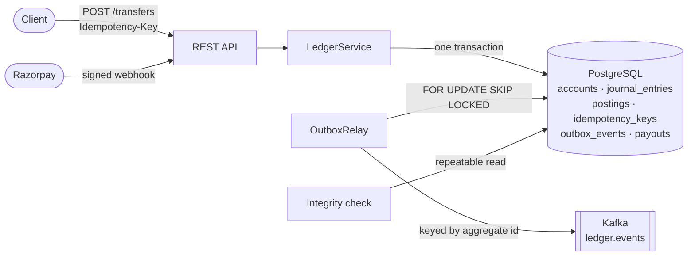

# Ledgerline

A double-entry payments ledger service: wallets, transfers and provider payouts,
built so that money is never created, lost or moved twice.

**Stack:** Java 21 · Spring Boot 4 · Spring Data JPA / Hibernate · PostgreSQL ·
Flyway · Kafka · Testcontainers · JUnit 5 · k6 · Docker Compose



## What it guarantees

| Invariant | How |
|---|---|
| Every entry balances | `LedgerService` rejects any entry whose debits and credits differ (checked with `Math.addExact`, so overflow throws instead of wrapping). |
| Balances never drift from postings | The cached balance and the posting rows are written in the same transaction; a scheduled check recomputes every balance from raw postings. |
| No lost updates under concurrency | Accounts are row-locked in id order before balances change (see [Locking](#locking-optimistic-first-then-ordered-row-locks)). |
| A retried request never moves money twice | `Idempotency-Key` is stored in the same transaction as the journal entry. |
| Events are published if and only if the change committed | Transactional outbox, no dual write. |
| Wallets never go negative | Checked in `Account#apply` and by a database `CHECK` constraint. |

## Domain

- **Accounts** have a type (`ASSET`, `LIABILITY`, `EQUITY`, `REVENUE`, `EXPENSE`)
  that decides which side increases the balance. A user wallet is a `LIABILITY`:
  the platform owes that money to the user.
- **Journal entries** are immutable groups of postings that sum to zero. Mistakes
  are fixed with a new, reversing entry, never by editing history.
- **Payouts** move through a state machine driven by provider webhooks. Each
  transition posts its own journal entry:

```
REQUESTED --payout.processed--> PROCESSED --payout.reversed--> REVERSED
    \--payout.failed / payout.rejected--> FAILED
```

| Step | Journal entry |
|---|---|
| Request | Debit wallet (amount + fee) · credit payouts-in-transit (amount) · credit fee revenue (fee) |
| Processed | Debit payouts-in-transit · credit bank |
| Failed | Debit payouts-in-transit · debit fee revenue · credit wallet (amount + fee) |
| Reversed | Debit bank · debit fee revenue · credit wallet (amount + fee) |

Holding the money in payouts-in-transit at request time means the wallet cannot
spend it twice while the provider is working.

## Design notes

### Locking: optimistic first, then ordered row locks

The first version used `@Version` optimistic locking with a retry around the
whole transaction. `ConcurrentTransferTest` (2,000 random transfers, 32 threads,
8 wallets) broke it: about 1,900 retries for 2,000 transfers, and some transfers
still ran out of retries. Optimistic locking fits when conflicts are rare.
A wallet ledger has hot accounts, so conflicts are common.

`LedgerService` now locks every account in the entry with
`SELECT ... ORDER BY id FOR UPDATE`. Because every transaction takes its locks in
the same order, two opposite transfers between the same pair of wallets queue
instead of deadlocking. The same test now runs with zero retries. `@Version`
stays as a backstop for any write path that bypasses the ledger, and
`LedgerTransactions` still retries the whole transaction on lock failures.

### Idempotency

`POST /transfers` and `POST /payouts` require an `Idempotency-Key` header.

- The key row (`scope`, `key`, request hash, response) is inserted in the **same
  transaction** as the journal entry, so either both exist or neither does.
- A retry with the same key and body replays the stored response with
  `Idempotent-Replayed: true`.
- The same key with a different body is rejected with `422 idempotency_key_reused`.
- Two concurrent requests with the same key race on the primary key. The loser's
  insert waits on the winner's lock, fails once the winner commits, rolls back
  its own postings, and replays the winner's response
  (`IdempotencyTest.concurrentDuplicatesPostExactlyOnce`).
- Only successes are stored, so a request rejected for insufficient funds can
  be retried with the same key once the wallet is topped up.
- Keys are purged after 24 hours.

### Transactional outbox

Publishing to Kafka straight from the service would be a dual write: the database
commit and the Kafka send can each fail independently. Instead each journal entry
and payout transition inserts an `outbox_events` row in its own transaction.
`OutboxRelay` claims unpublished rows with `FOR UPDATE SKIP LOCKED`, which lets
several instances drain the table without blocking each other. It sends them keyed
by aggregate id, so one aggregate's events stay ordered on one partition.

Delivery is at-least-once: a crash after Kafka acknowledges a send but before the
row is marked published sends that event again. Every event carries an `eventId`
for consumers to deduplicate on.

The first relay waited for each acknowledgement before sending the next event,
and drained about **180 events/s**. A load test at 1,000 transfers/s left a
backlog of 230K events. The relay now hands the whole batch to the producer
before waiting, and Kafka's idempotent producer keeps order per partition. That
drains about **8,450 events/s**, and the backlog stays at zero under full load.

### Webhooks

- **Signature:** the Razorpay signature is an HMAC-SHA256 of the raw body. It is
  verified before parsing, with a constant-time comparison.
- **Concurrency:** the payout row is locked for the transition, so two webhooks
  for the same payout cannot apply twice.
- **Duplicate deliveries** are a no-op.
- **Authentic but inapplicable events** (unknown payout, or `failed` after
  `processed`) get `200 ignored`. A non-2xx response would make the provider
  redeliver an event that can never succeed.

### Integrity check

Every 10 minutes, `LedgerIntegrityService` recomputes both invariants from raw
postings inside one `REPEATABLE READ` snapshot, so in-flight transfers cannot
cause false alarms. It exports the `ledgerline.integrity.violations` gauge and
backs a `ledger` health indicator. The tests tamper with balances and postings
directly to prove the check catches writes that bypass the ledger.

## Load test

[`loadtest/transfers.js`](loadtest/transfers.js) creates 200 funded wallets, then
fires random wallet-to-wallet transfers at a constant arrival rate, each with its
own idempotency key.

**Setup:** everything ran on one laptop (Ryzen 5 5600H, 6 cores / 12 threads,
16 GB) via Docker Compose, with k6, Kafka and Postgres competing with the app for
CPU. Each run was 60 s, after a warm-up.

| Target rate | Achieved | p50 | p95 | p99 | Errors | Outbox backlog after |
|---|---|---|---|---|---|---|
| 1,250/s | 1,214/s | 7.2 ms | 14.2 ms | 35.4 ms | 0% | 0 |
| 1,500/s | 1,459/s | 7.9 ms | 20.7 ms | 58.4 ms | 0% | 0 |
| 1,500/s (repeat) | 1,456/s | 7.6 ms | 25.2 ms | 93.6 ms | 0% | 0 |
| 1,750/s | 1,494/s | 13.8 ms | 418 ms | 461 ms | 0% | 0 |

On this machine throughput levels off around **1,450–1,500 transfers/s**. Past that,
latency climbs instead of throughput. After about 400K journal entries the
integrity check reported zero violations.

## Running it

```bash
docker compose up --build     # Postgres, Kafka and the service on :8080
# if a local Postgres already holds 5432: POSTGRES_PORT=5434 docker compose up --build

./mvnw verify                 # 42 tests; needs Docker for Testcontainers

docker run --rm -i --network host grafana/k6 run - < loadtest/transfers.js
# options: -e RATE=1500 -e DURATION=60s -e WALLETS=200
```

## API

```bash
# open two wallets and a bank account
curl -s localhost:8080/api/v1/accounts -H 'Content-Type: application/json' \
  -d '{"code":"bank:demo","name":"Bank","type":"ASSET","currency":"INR","overdraftAllowed":true}'
curl -s localhost:8080/api/v1/accounts -H 'Content-Type: application/json' \
  -d '{"code":"wallet:asha","name":"Asha","type":"LIABILITY","currency":"INR"}'

# move 250.00 INR (amounts are in paise); retrying with the same key is safe
curl -s localhost:8080/api/v1/transfers -H 'Content-Type: application/json' \
  -H 'Idempotency-Key: 7f9c2b1e-topup-1' \
  -d '{"debitAccountId":"<bank id>","creditAccountId":"<wallet id>","amount":25000,"currency":"INR"}'
```

| Method | Path | |
|---|---|---|
| `POST` | `/api/v1/accounts` | Open an account |
| `GET` | `/api/v1/accounts/{id}` | Account with cached balance |
| `GET` | `/api/v1/accounts/{id}/postings?page=&size=` | Statement, newest first |
| `POST` | `/api/v1/transfers` | Two-leg transfer (`Idempotency-Key` required) |
| `POST` | `/api/v1/payouts` | Request a payout (`Idempotency-Key` required) |
| `GET` | `/api/v1/payouts/{id}` | Payout status |
| `POST` | `/api/v1/webhooks/razorpay` | Provider webhook (`X-Razorpay-Signature`) |
| `GET` | `/api/v1/ledger/integrity` | Run the integrity check now |
| `GET` | `/actuator/health`, `/actuator/prometheus` | Health and metrics |

Errors use RFC 9457 problem details. Business-rule failures return `422` with a
machine-readable `code`: `insufficient_funds`, `unbalanced_entry`,
`currency_mismatch`, `same_account` or `idempotency_key_reused`.

## Not built yet

- **Hot system accounts:** platform accounts like the bank serialise every payout
  through one row. The usual fix is to split them into N sub-accounts and sum them
  for reporting.
- **Authentication and authorisation:** the API currently trusts its caller.
- **Payout dispatcher:** the consumer of `PayoutRequested` that calls the
  provider's payout API.
- **Multi-currency:** each entry is single-currency; FX would need its own entries.
